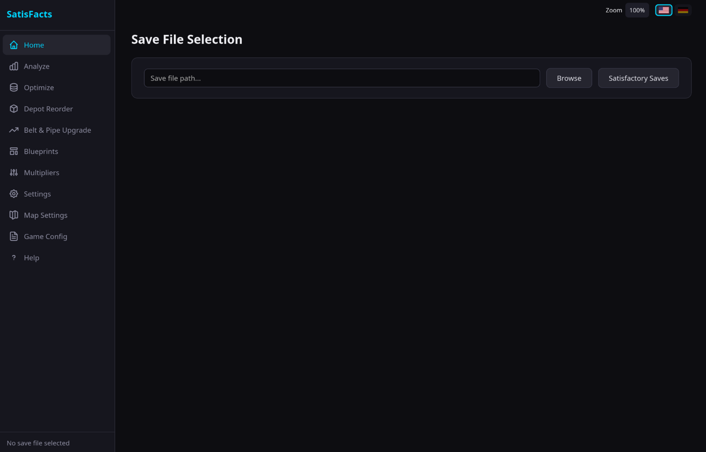
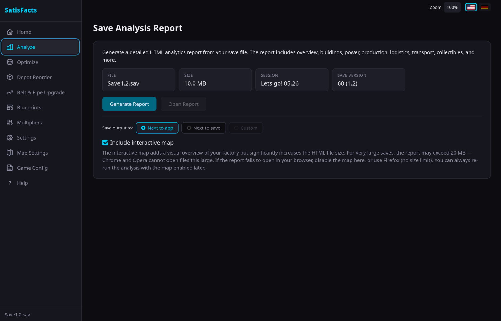
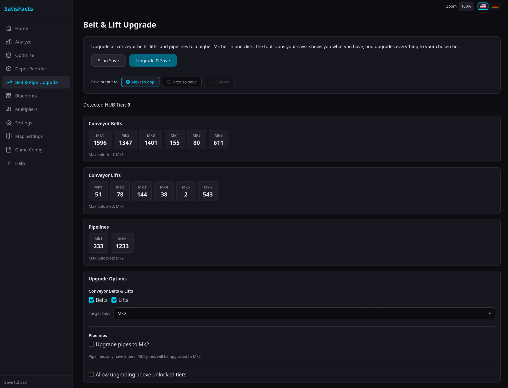
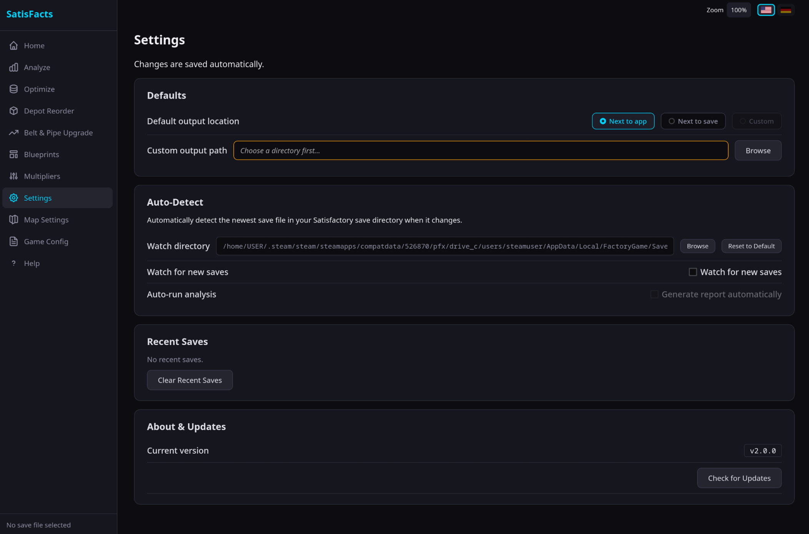
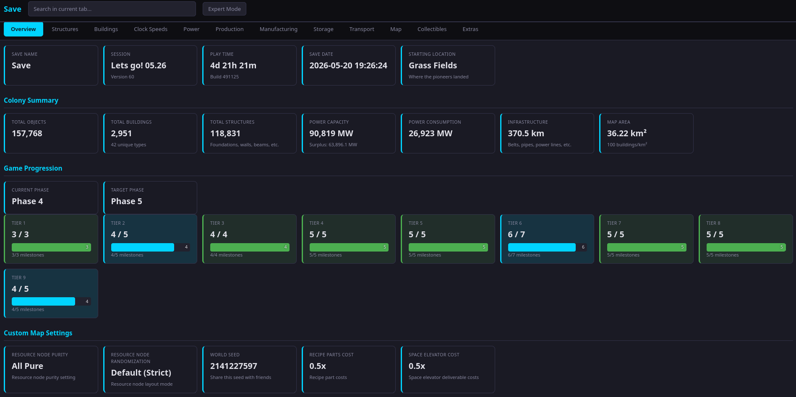
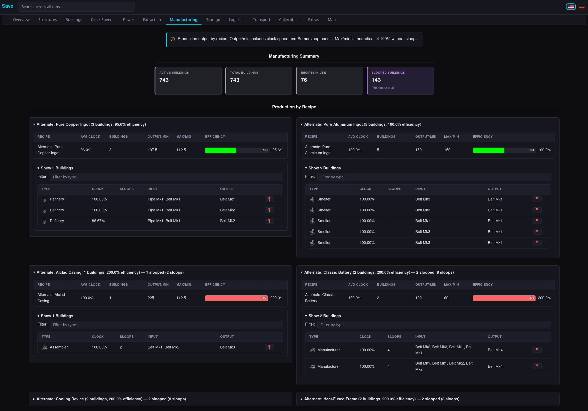
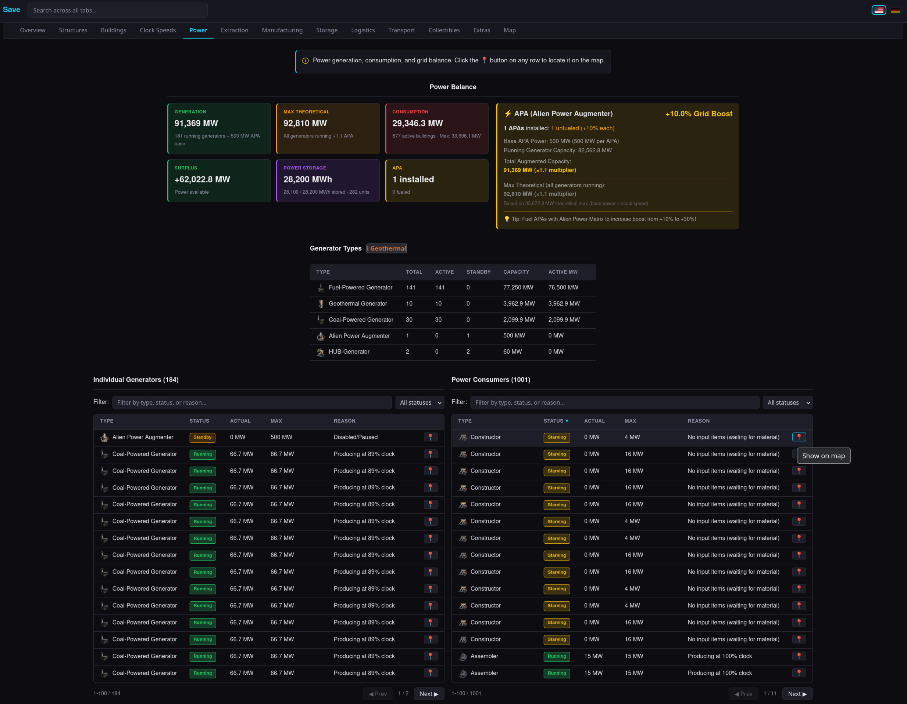
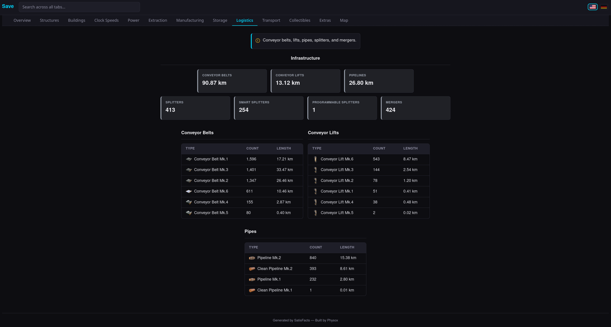
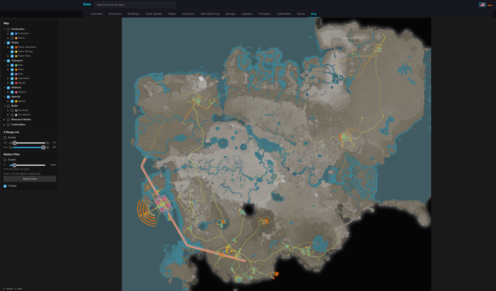
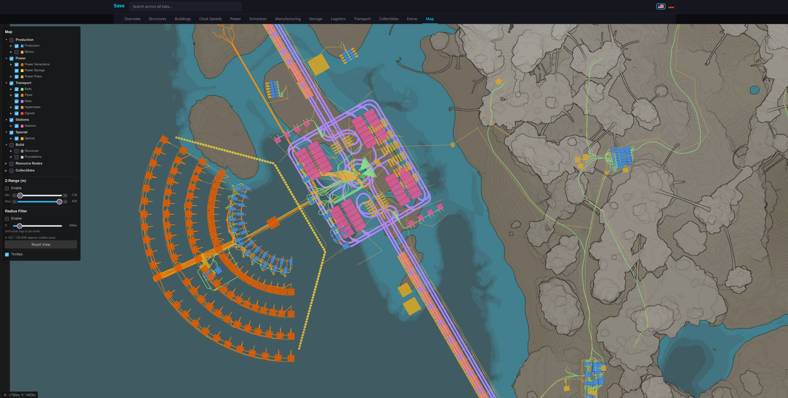

# SatisFacts

**Developed by Physox**

SatisFacts is a desktop application for inspecting and editing Satisfactory save files. It analyzes your factory as a system — reconstructing relationships between game objects, detecting bottlenecks, and generating interactive reports with hundreds of detailed statistics. It also includes a suite of save editing tools: reorder depot items, upgrade belts and pipes, patch game multipliers, copy blueprint categories, fix session names, tweak game config files, and reduce file size.

[](https://github.com/PhysoxNB/SatisFacts/releases)
[](https://github.com/PhysoxNB/SatisFacts/releases)
[](LICENSE)
[](https://physox.itch.io/satisfacts-satisfactory-save-file-analyzer)

## Screenshots

**App**

| Home | Analyze |
|------|---------|
|  |  |

| Belt & Pipe Upgrade | Settings |
|--------------|----------|
|  |  |

**Report**

| Overview | Manufacturing |
|----------|---------------|
|  |  |

| Power | Logistics |
|-------|----------------------------------------|
|  |  |

| Interactive Map (zoomed out) | Interactive Map (zoomed in) |
|------|------|
|  |  |

## Contents

- [Highlights](#highlights)
- [The Report](#the-report)
- [Save Tools](#save-tools)
- [Quick Start](#quick-start)
- [App Features](#app-features)
- [Output Location](#output-location)
- [Requirements & Performance](#requirements--performance)
- [Build from Source](#build-from-source)
- [Special Thanks](#special-thanks)
- [Support & Feedback](#support--feedback)
- [Support the Project](#support-the-project)
- [License](#license)

## Highlights

SatisFacts analyzes your factory as a system, not just a list of objects.

- **Find out what's broken** — it points at the machines that are blocked, starving, switched off, or standing idle, so you know where to look first
- **See what you're really producing** — every machine's actual output next to what it *should* be making at its current clock speed, so the underperformers stand out
- **Connect the dots** — which locomotives and wagons belong to which train, which drone stations are paired up, and what feeds each machine and carries its output away
- **Measure your rail network** — how far each train actually travels on a full round trip
- **Handles enormous factories** — tested on saves up to 568 MB with 17.5 million objects, without running your PC out of memory
- **One file you can just open** — the whole report is a single HTML file. It works offline in any browser (reports from very large saves may need Firefox), and you can send it to a friend
- **Edit your saves** — reorder depot items, upgrade all belts/lifts/pipes in one click, patch game multipliers beyond UI limits, copy blueprint categories between saves, fix session names, reduce file size (typically by 10–23%), and tweak game config files (UObject limit, console key)
- **Interactive map** — a WebGL-powered factory map embedded right in the report. Pan, zoom, and toggle categories on and off to see exactly where everything is — buildings, belts, pipes, rails, power lines, resource nodes, and collectibles
- **Bilingual** — the app and the HTML report both support English and German, switchable at any time

## The Report

The generated HTML report is a self-contained interactive file with 14 tabs:

| Tab | What's in it |
|-----|--------------|
| **Overview** | Save info, colony summary, and custom map settings (1.2+) |
| **Structures** | Foundations, walls, beams, lights, signs, statues |
| **Buildings** | Every building categorized by function — production, power, mining, storage, transport |
| **Clock Speeds** | Overclock/underclock distributions, plus how many buildings at each clock speed also have somersloops inserted |
| **Power** | Generator capacity, consumption, and factory-wide power balance (surplus/deficit), plus power circuit topology with component counts |
| **Extraction** | Miners and fluid extractors with resources, purities, clock speeds, capacities, and locations |
| **Manufacturing** | Recipe efficiency, production rates, bottleneck detection |
| **Storage** | Containers, dimensional depots, per-container contents, and items currently riding on belts |
| **Logistics** | Conveyor belts, lifts, pipes, splitters, mergers, power lines |
| **Transport** | Hypertubes, trains, vehicles, and drones with detail tables and round-trip route distances |
| **Nuclear** | Uranium, plutonium, and ficsonium plants with fuel levels, waste production rates, and stored waste |
| **Collectibles** | Power slugs, somersloops, mercer spheres, and crash sites with collected-vs-total counts and the locations of everything still out there |
| **Extras** | Space elevator phases, milestone tiers, MAM research trees, AWESOME Sink coupons, per-player inventory, visited areas, creatures killed, consumables consumed, pets, blueprints |
| **Map** | Interactive WebGL factory map — every building, belt, pipe, rail, power line, hypertube, resource node, and collectible rendered at its real-world position. Pan, zoom, filter by category, type, altitude, or radius. Click 📍 in any table to jump straight to that object on the map |

Every tab includes:

- **Search everything at once** — type anything into the search box and it searches across every tab, grouped by where it found them. Click a result to jump straight there
- **Sortable tables** — click any column heading to sort by it. Big tables are split into pages, and sorting still covers the whole table, not just the page you're on
- **Filters** — each big table has its own filter box, and the detail tables let you narrow down by status
- **Collapsible sections** — open up the details for a building only when you want them
- **Charts** — bars showing how your clock speeds, somersloops and power are spread out
- **Icons everywhere** — every building, structure, and item shows its in-game icon
- **English & German** — switch the entire report language with the flag buttons in the header
- **Interactive map** — a GPU-accelerated WebGL map renders every object at its real position. Toggle categories on/off, filter by object type, altitude range, or radius around a point. Hover for tooltips, click 📍 in any table to fly to that object
- **Customizable map colors** — every map category color can be customized in the app's Map Settings tab, and the choices carry through to the report
- **No empty clutter** — sections and tabs with no data in them disappear on their own, so you only see what your save actually contains

## Save Tools

Beyond analysis, SatisFacts includes a set of save editing tools. Each tool produces a new save file — your original is never modified (except session name fix with explicit overwrite). Game Config is the exception: it edits game configuration files directly, with automatic backups.

| Tool | What it does                                                                                                      |
|------|-------------------------------------------------------------------------------------------------------------------|
| **Analyze** | Generates an interactive HTML report from your save file                                                          |
| **Optimize** | Reorganizes objects by class name for better zlib compression, typically reducing file size by 10–23% with no data loss  |
| **Depot Reorder** | Drag-and-drop reordering of Dimensional Depot items — the save file order determines the in-game display order    |
| **Belt & Pipe Upgrade** | Upgrades all conveyor belts, lifts, and pipelines to a target Mk tier in one click                                |
| **Multipliers** | Patches custom game cost multipliers (recipe, space elevator, power consumption) beyond the in-game UI limits.    |
| **Blueprint Categories** | Copies blueprint folder structure between saves, or exports/imports them as portable `.sfbcat` preset files. Replace or merge mode |
| **Session Name Fix** | Detects and repairs problematic session names (trailing spaces, invalid Windows characters) that can cause issues |
| **Game Config** | Edits Satisfactory's Engine.ini (UObject limit) and Input.ini (console key) with automatic backup and restore     |

> **Want a new tool?** I'm always open to adding new save editing features. If you have an idea for something that would be useful, [open an issue on GitHub](https://github.com/PhysoxNB/SatisFacts/issues) or [reach out on Discord](https://discord.com/users/364893122531950592).

## Quick Start

Grab a ready-to-use build from the [**Releases**](https://github.com/PhysoxNB/SatisFacts/releases) page or [**itch.io**](https://physox.itch.io/satisfacts-satisfactory-save-file-analyzer) — no need to install anything.

### Windows
1. Download `SatisFacts.exe`.
2. **Double-click to launch.** You can put it anywhere — no need to place it in your save folder.
3. Click **Browse** to pick a `.sav` file, or just drag-and-drop one onto the window. You can also click **Satisfactory Saves** to jump straight to your save folder.
4. Switch to the **Analyze** tab and click **Generate Report**. When it's done, click **Open Report** to view it in your browser.

> **Heads-up (Windows SmartScreen / antivirus):** SatisFacts is an open-source,
> unsigned executable, so Windows Defender SmartScreen may warn "Windows protected
> your PC", and some antivirus tools may flag it as a false positive. This is normal
> for unsigned indie tools. Click **More info → Run anyway**, or build it yourself
> from source (below). The full source is here for you to inspect.

### Linux
Requires the GTK 3 and WebKitGTK 4.1 libraries (`libgtk-3` and `libwebkit2gtk-4.1`).

1. Download `SatisFacts` and make it executable: `chmod +x SatisFacts`
2. **Double-click to launch**, or run `./SatisFacts` from a terminal.
3. Click **Browse** to pick a `.sav` file, or drag-and-drop one onto the window.
4. Switch to the **Analyze** tab and click **Generate Report**.

### macOS
1. Download `SatisFacts.app.tar.gz` and extract it.
2. **Double-click `SatisFacts.app`** to launch.
3. Click **Browse** to pick a `.sav` file, or drag-and-drop one onto the window.
4. Switch to the **Analyze** tab and click **Generate Report**.
> On first run macOS Gatekeeper may block it ("cannot be opened because the developer
> cannot be verified"). Allow it via **System Settings → Privacy & Security → Open Anyway**,
> or run `xattr -d com.apple.quarantine /path/to/SatisFacts.app`.

### Where your saves live

**Windows:**
```
%LOCALAPPDATA%\FactoryGame\Saved\SaveGames\<your_id>\
```

**Linux:**
```
~/.steam/steam/steamapps/compatdata/526870/pfx/drive_c/users/steamuser/AppData/Local/FactoryGame/Saved/SaveGames/<your_id>/
```

The app's **Satisfactory Saves** button navigates to this folder automatically.

See the [CHANGELOG](CHANGELOG.md) for what's new.

## App Features

- **Drag & drop** — drop any `.sav` file onto the window to load it instantly
- **Recent saves** — recently loaded saves appear on the Home page for quick access
- **Auto-detect** — automatically load the newest save from your save directory whenever it changes (enable in Settings)
- **Auto-analyze** — optionally generate a report automatically each time a new save is detected
- **Chain operations** — after running one tool, the next can chain onto the previous output instead of starting from the original
- **Check for updates** — the Settings page shows the current version and checks GitHub for new releases
- **Help page** — built-in getting started guide, feature overview, FAQ, and support links
- **Map Settings** — customize the colors of every map category (buildings, belts, pipes, rails, collectibles, and more). Colors are saved and applied to the report's interactive map
- **Include map toggle** — choose whether to embed the interactive map in the report (enabled by default, can be disabled to speed up analysis or reduce report size)
- **Zoom control** — adjust the UI zoom level (80%–150%) from the header dropdown, saved across sessions
- **Window size persistence** — the app remembers its window size between launches
- **English & German** — switch the app language with the flag buttons in the top right

## Output Location

Every tool that writes a save file or report lets you choose where the output goes:

- **Next to app** — writes to the same folder as the SatisFacts executable
- **Next to save** — writes to the folder containing the source save file
- **Custom** — writes to a directory you choose (set it up in Settings first)

The default output location can be configured in Settings and applies to all tabs.

## Requirements & Performance

### Supported save versions

- v46 (1.0), v52 (1.1), v60 (1.2)
- Modded saves supported (most mods work automatically)
- Large saves tested up to 568 MB (~17.5M objects)
- Very large saves can produce reports of 30 MB or more (31 MB for the 568 MB save). If your browser won't open one, use Firefox, or turn off the map on the **Analyze** tab to make the report much smaller

### Benchmarks

| Save Size | Objects    | Peak RSS | Time     |
|-----------|------------|----------|----------|
| 9 MB      | 134,361    | 237 MB   | ~2s      |
| 10 MB     | 157,768    | 255 MB   | ~1.6s    |
| 42 MB     | 774,503    | 1.1 GB   | ~8.5s    |
| 133 MB    | 2,194,755  | 2.4 GB   | ~14s     |
| 443 MB    | 12,958,497 | 12 GB    | ~2m35s   |
| 568 MB    | 17,515,367 | 16.5 GB  | ~3m40s   |

Times were measured on a desktop CPU and will vary with your hardware. The streaming parser reads directly from disk — no full file load — and objects are processed in a single pass. Peak RAM comes from the post-extraction analytics phase, which holds compact typed data for building cross-references.

**RAM scales with save size:** During analysis, peak RSS is roughly 25–30× the save file size. A 568 MB save peaks at ~16.5 GB RSS. 16 GB RAM handles saves up to ~450 MB (close other apps); 32 GB covers saves up to ~1 GB. The only real limit is your available RAM.

The save tools load the whole decompressed save into memory, so they need about as much RAM as analysis. Optimize peaked at 4.1 GB on a 132 MB save and 14.3 GB on a 443 MB save, and warns you first if your PC may not have enough free RAM.

### Data notes

- **Resource node purity:** Extracted from the save file when available (v1.2+), falling back to bundled data for older saves.
- **Geothermal generators:** Purity is inferred from actual MW output and fluctuation cycle data using a triangle-wave formula with phase-shift fitting, since geyser nodes don't store purity in the save file.
- **Modded buildings:** Power output, recipes, clock speeds, and other properties are extracted generically from save data — most mods work automatically without hardcoded support. Modded building names are cleaned up from class names but not fully translated to in-game names, since translating every building from every available mod is impractical. Vanilla buildings are fully translated.

## Build from Source

Requires **Go 1.27.1+**, **Node.js**, the [Wails CLI](https://wails.io/docs/gettingstarted/installation), and [esbuild](https://esbuild.github.io/) (`npm install -g esbuild` or use `npx`). On Linux you also need the GTK 3 and WebKitGTK 4.1 development packages:

```bash
# Install Wails CLI
go install github.com/wailsapp/wails/v2/cmd/wails@v2.13.0

# 1. Generate the minified viewer JS (needed by go:embed)
bash minify_viewer.sh

# 2. Copy the map image (needed by go:embed)
mkdir -p extraction/assets && cp assets/Map.webp extraction/assets/Map.webp

# 3. Build for your current platform (output in ui/build/bin/)
cd ui
wails build
```

Or use the build script, which does all three steps automatically:

```bash
./build.sh           # Linux
./build.sh windows   # Windows cross-compile
./build.sh all       # Both
```

## Special Thanks

This tool would not exist without the Satisfactory community. A few people in particular made it possible:

- **Chaos1699** — The original inspiration for this project. His 132MB save (MaxPower) was the first one I ever analyzed, and the experience of trying to parse it with existing tools (3 hours, raw data only, no analytics) is what motivated me to build something better. Without him, none of this would exist.
- **BLAndrew575** — Provided the most extreme test cases imaginable, with saves ranging from 200MB to 442MB, and helped brainstorm features throughout development. Without his massive factories to stress-test against, the performance optimizations and memory handling that make this tool stand out simply wouldn't have been possible.
- **IdjitsGaming** — gave valuable suggestions for improvement and helped find bugs with his complex save file during the final polish phase.

To everyone who shared their saves, reported bugs, and provided feedback — thank you. This tool is as much yours as it is mine.

## Support & Feedback

- **Found a bug or have a feature idea?** Open an [issue on GitHub](https://github.com/PhysoxNB/SatisFacts/issues).
- **Prefer to chat?** Find me on Discord: [**physox.**](https://discord.com/users/364893122531950592)

## Support the Project

If SatisFacts has been helpful to you and you'd like to support its continued development, consider buying me a coffee:

- [**Ko-fi**](https://ko-fi.com/physox)

Every contribution helps motivate continued development, bug fixes, and support for new game versions. Thank you!

## License

The source code of this project is licensed under the **GNU General Public License v3.0** (GPL-3.0). See [LICENSE](LICENSE) for the full text.

**Exceptions:** Game icons in `assets/icons/`, the map image `assets/Map.webp`, and game-derived data in `extraction/report/data/` are copyrighted by Coffee Stain Studios AB and are **not** covered by the GPL-3.0 license. See [THIRD_PARTY_ASSETS.md](THIRD_PARTY_ASSETS.md) for details.

## Code signing policy

See [CODE_SIGNING_POLICY.md](CODE_SIGNING_POLICY.md)

---

*Not affiliated with or endorsed by Coffee Stain Studios. Satisfactory is a trademark of Coffee Stain Studios.*
